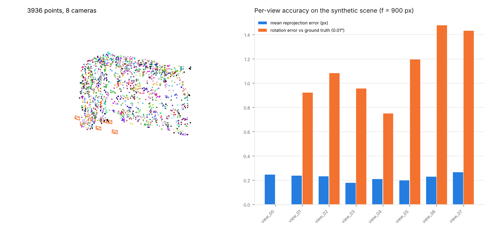
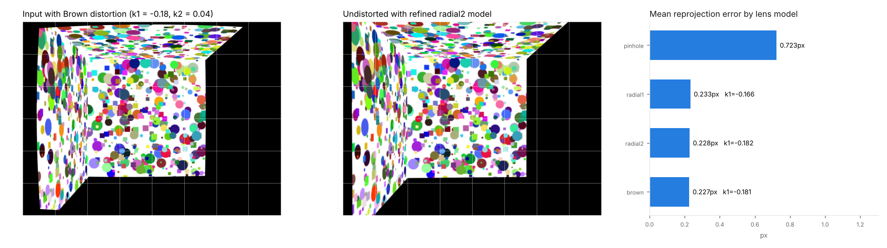
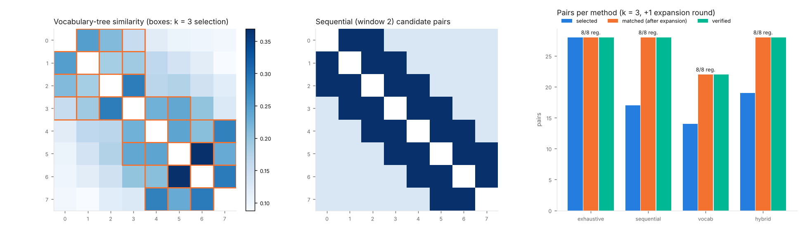
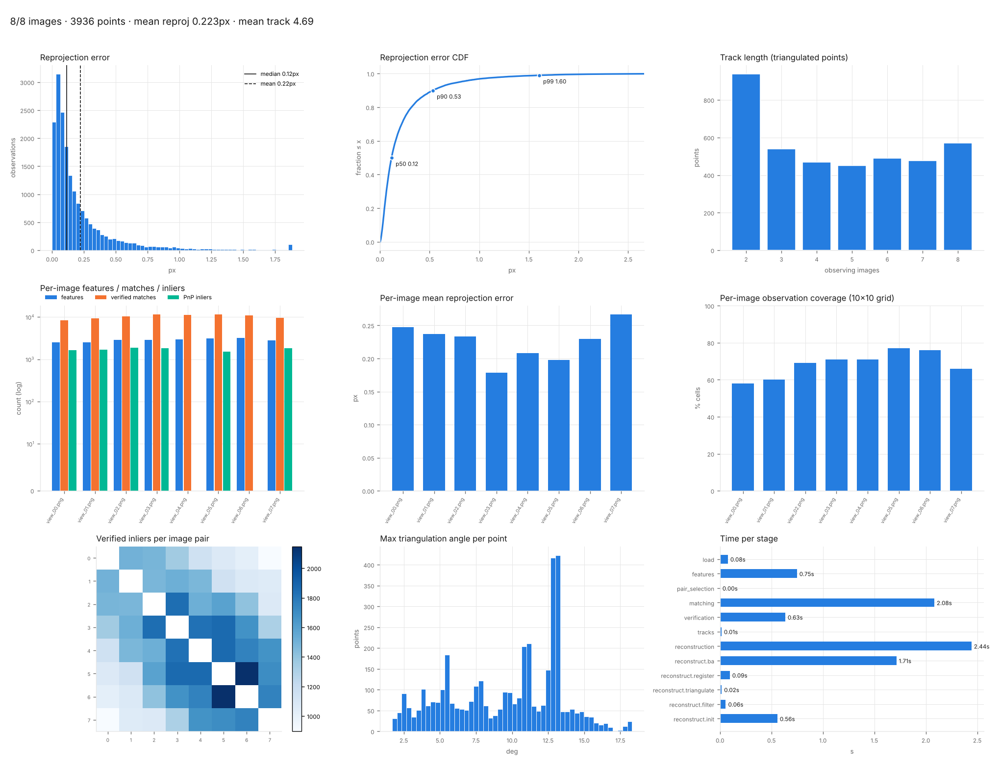
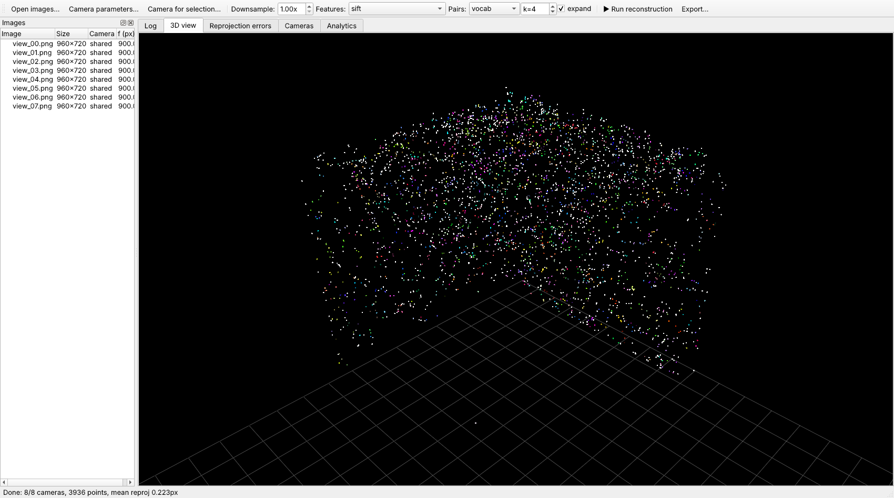
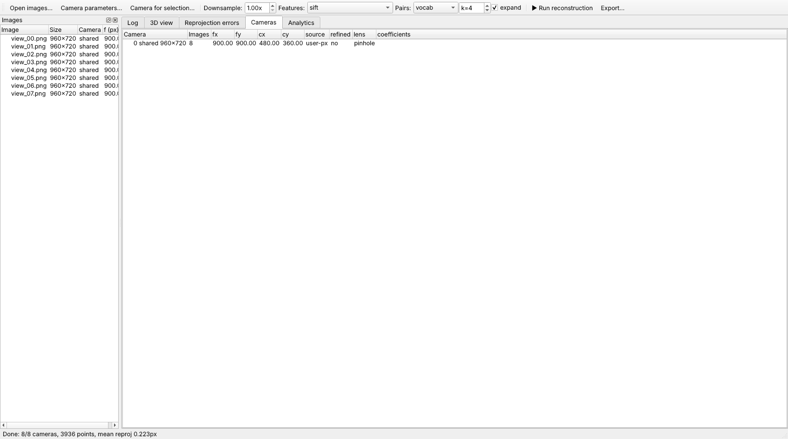
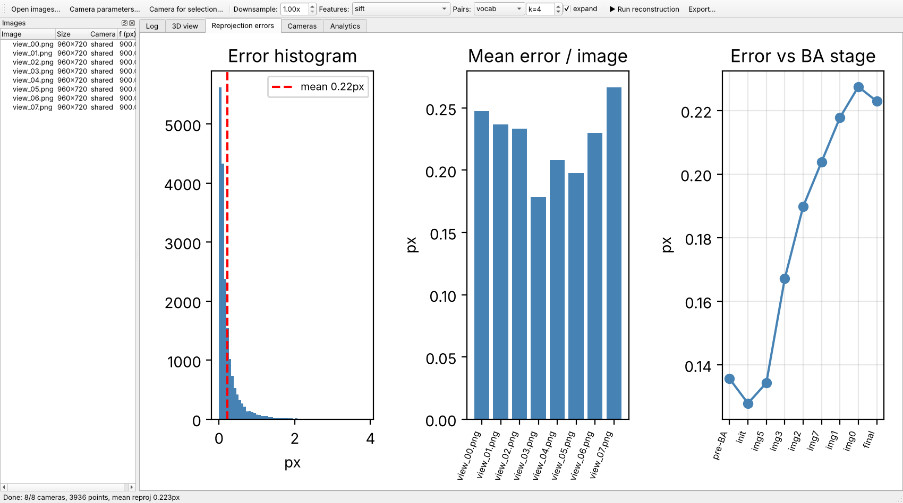
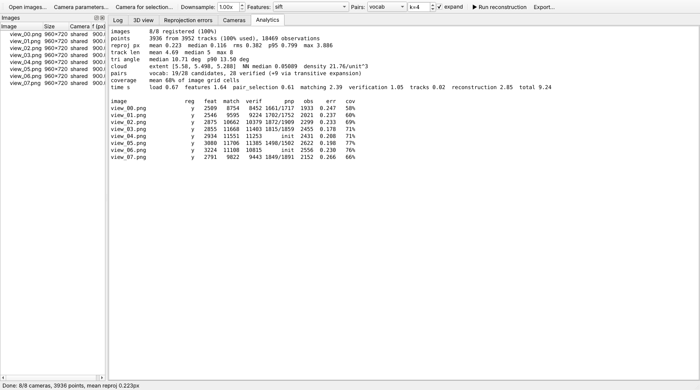
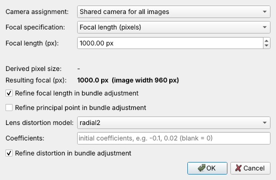

# SfM Toolbox

I've been into SfM, and LF reconstruction for a while and wanted a better understanding of feature matching and bundle adjustment pipelines that are practically used. It does incremental Structure-from-Motion from scratch, in the style of COLMAP [1, 2]. You give it a folder of photos and it gives you back camera poses, intrinsics and a colored point cloud. All the multi-view geometry is my own NumPy code: the eight-point algorithm, RANSAC, pose recovery, triangulation, PnP and a Schur-complement bundle adjuster with an analytic Jacobian. OpenCV and PyTorch are only used to detect and match features.

There is a PyQt GUI for interactive use, a CLI for batch runs, and a Python API if you want to drop it into your own code.



## Install and run

You need Python 3.10 or newer, and `git` on your PATH (LightGlue installs from GitHub).

```bash
git clone https://github.com/gaschenb/SfM-Toolbox.git && cd SfM-Toolbox
python -m venv .venv
# Windows: .venv\Scripts\activate     macOS/Linux: source .venv/bin/activate

# 1. Remove any other OpenCV wheel. They all install the same cv2 module,
#    and a non-contrib one hides AKAZE/BRISK/KAZE.
pip uninstall -y opencv-python opencv-python-headless opencv-contrib-python opencv-contrib-python-headless

# 2. PyTorch for DISK and SuperPoint. CPU-only build:
pip install torch --index-url https://download.pytorch.org/whl/cpu
#    or, with an NVIDIA GPU, use the CUDA command from https://pytorch.org/get-started/locally/

# 3. Everything else (OpenCV contrib headless, kornia, LightGlue, GUI deps)
pip install -r requirements.txt
pip install -e .

# 4. Check that every extractor reports "ok"
sfm-toolbox --list-features
```

| extractor | provided by |
|---|---|
| `sift`, `rootsift`, `orb` | `opencv-contrib-python-headless` (also in plain OpenCV) |
| `akaze`, `brisk`, `kaze` | `opencv-contrib-python-headless` (contrib only on OpenCV 5) |
| `disk` | `torch` + `kornia`, weights download from Hugging Face on first use |
| `superpoint` | `torch` + `lightglue`, weights download on first use |

Use the headless OpenCV build. The Qt plugins bundled with `opencv-python` conflict with PyQt5. If an extractor is missing, the GUI greys it out and the hover text tells you which package to install.

To run it:

1. GUI: `sfm-toolbox-gui` (or `python -m sfmtoolbox`).
2. CLI: `sfm-toolbox --images DIR --out OUT`.
3. Quick try on synthetic data: `python -m sfmtoolbox.examples.make_synthetic_images` and then `sfm-toolbox --images synthetic_images --out out --focal-px 900`.

## Features

1. Eight feature extractors behind one registry: SIFT [3], RootSIFT [4], ORB [5], AKAZE [6], BRISK [7], KAZE [8], DISK [9] and SuperPoint [10]. You can register your own.
2. Brute-force or FLANN [11] matching with Lowe's ratio test [3] and a mutual cross-check.
3. Six lens models (pinhole, radial1/2/3, Brown-Conrady [12, 13] and equidistant fisheye [14]), with coefficients that can be refined in bundle adjustment and an option to write undistorted images.
4. Non-exhaustive pair selection so you aren't stuck with O(n²) matching: sequential, vocabulary tree [15], VLAD [16], GPS, hybrid, plus transitive expansion.
5. Flexible intrinsics: focal in pixels, mm + sensor width, mm + pixel pitch, 35 mm equivalent, EXIF, or a heuristic. Cameras can be shared or per image, with focal and principal point refinement.
6. Analytics on every run: a text summary, JSON, a per-image CSV and a 9-panel figure.
7. Exports a colored `points.ply` and `poses.json`.

## Methods

The pipeline follows the standard incremental SfM loop [1, 2]. Each step is its own module in `sfmtoolbox/core`.

1. **Features and tracks** (`features.py`). Keypoints and descriptors come from the chosen extractor. Matches pass the ratio test [3] and a mutual check, then a union-find builds tracks and drops any track that hits the same image twice. RootSIFT is SIFT with L1 normalization and a square root, so Euclidean distance acts like the Hellinger kernel [4]. Binary descriptors (ORB, AKAZE, BRISK) use Hamming distance.
2. **Pair selection** (`pairs.py`). This picks which image pairs get matched at all.
   1. `exhaustive`: all n(n-1)/2 pairs.
   2. `sequential`: each image with the next `--seq-window` images, plus loop closure between the first and last window.
   3. `vocab`: a hierarchical k-means vocabulary tree (branching 8, depth 4) scored with TF-IDF, keeping the top k per image [15].
   4. `vlad`: a VLAD global descriptor (64 words, power and L2 normalized) with cosine kNN [16].
   5. `gps`: kNN on EXIF GPS. It falls back to `vocab` if any image has no GPS.
   6. `hybrid`: the union of sequential and vocab (and gps when it's available).
   7. Transitive expansion (`--expand N`): after verification, if (i, j) and (j, k) both verified, (i, k) gets matched and verified too. This repeats N times.
3. **Two-view geometry** (`geometry.py`, `pose.py`). F comes from the Hartley-normalized eight-point algorithm [17] with rank-2 enforcement, inside adaptive RANSAC [18, 2] scored by Sampson error. I batch the RANSAC hypotheses so a whole round is one eigen-decomposition call. E = K_jᵀ F K_i gets projected onto the essential manifold, and the right one of the four (R, t) decompositions is picked by cheirality [2].
4. **Initialization** (`reconstruction.py`). The initial pair is the one with the best inlier count times triangulation angle. Its points are triangulated without the reprojection gate, bundle adjusted, then filtered. If fewer than 30 points survive, it moves on to the next candidate pair (up to 10). This matters a lot for distorted images, where a slightly biased initial pose would otherwise reject every point.
5. **Registration** (`pnp.py`). Each new view is posed with DLT PnP [2] in batched RANSAC [18], then refined with a Huber loss [19].
6. **Triangulation** (`triangulation.py`). Multi-view DLT [2], gated on depth, reprojection error and ray angle.
7. **Bundle adjustment** (`bundle_adjustment.py`). This minimizes pixel reprojection error over poses (axis-angle and translation, first camera fixed), points, and optionally per-group intrinsics and distortion [20].
   1. The Jacobian is analytic. The rotation derivative uses the closed form of Gallego and Yezzi [21].
   2. The solver is Levenberg-Marquardt [22, 23] with Marquardt scaling and IRLS Huber weights [19].
   3. Points are eliminated with a 3×3 block Schur complement [20]. The reduced camera system is dense up to 512 camera parameters and sparse beyond that.
   4. `solver='scipy'` runs SciPy's trust-region solver with the same Jacobian, if you want a reference.
8. **Lens distortion** (`distortion.py`, `camera.py`). Brown-Conrady [12, 13] uses (k1, k2, p1, p2, k3) and fisheye is equidistant with k1 to k4 [14]. All of them have analytic Jacobians. Undistortion uses Newton iterations, RANSAC runs on undistorted keypoints, and every projection goes through the model.
9. **Self-calibration**. If the focal is a heuristic guess and refinement is on, a coarse focal grid search on the strongest pair runs first so BA doesn't land in the focal/depth local minimum.

Conventions: `X_cam = R X_world + t`, camera center `C = -Rᵀ t`, `x₂ᵀ F x₁ = 0`.

## Results/Examples

All of these come from the synthetic scene in `sfmtoolbox/examples`: 8 views of a textured three-plane corner at f = 900 px, with known poses. To rebuild the figures, run `python -m sfmtoolbox.examples.gallery docs/figures`.

1. **Accuracy.** With SIFT and exhaustive pairs, all 8 views register and the reconstruction has 3936 points. Mean reprojection error is about 0.22 px per view and rotation error against ground truth is under 0.015° (figure at the top).
2. **Lens distortion.** I warped the same images with Brown distortion (k1 = -0.18, k2 = 0.04). A pinhole fit only gets down to 0.72 px. Refining radial2 brings it to 0.23 px and recovers k1 = -0.182. Brown recovers k1 = -0.181.

   

3. **Pair selection.** With k = 3, the vocabulary tree picks 14 of the 28 possible pairs and still registers all 8 views. The boxes on the left are the pairs it chose. The similarity is highest between neighboring views, which is what you want.

   

4. **Analytics.** Every run writes this figure: the error histogram and CDF, track lengths, per-image counts, error and coverage, the pair inlier matrix, triangulation angles and stage timings.

   

5. **Speed.** Compared with the first version of this toolbox on the same images and machine, the full SIFT run dropped from 64.2 s to 6.5 s and the ORB run from 117.3 s to 17.1 s. Most of that came from batched RANSAC and the Schur-complement LM solver.

## GUI



```bash
sfm-toolbox-gui [--images folder]
```

1. **Open images.** Load a folder. The list shows each image's size, camera assignment and resolved focal.
2. **Camera parameters.** Pick shared or per-image cameras and enter the focal in whatever units you have: pixels, mm + sensor width, mm + pixel size, mm + sensor width + native resolution, 35 mm equivalent, or Auto (EXIF, then a heuristic). The focal in pixels updates live. This is also where you pick the lens model, give starting coefficients, and choose what BA refines.
3. **Camera for selection.** Select some images and give just those their own camera.
4. **Features, Pairs and k.** Pick the extractor and the pair selection method. Hover over the Pairs options and k to see what each one does.
5. **Downsample.** A linear factor applied before processing. Exported intrinsics refer to the downsampled images.
6. **Run reconstruction.** It runs in the background with a live log and a live 3D view (pyqtgraph OpenGL, with a matplotlib fallback). Click a camera frustum to see its image name and center.
7. **Tabs.** Log, 3D view, Reprojection errors, Cameras and Analytics.
8. **Export.** Writes `points.ply`, `poses.json` and the plots.

| Cameras | Reprojection | Analytics |
|---|---|---|
|  |  |  |



## CLI

```bash
sfm-toolbox --images imgs/ --out out/ [intrinsics] [options]
```

Give the intrinsics in one of these ways:

1. `--focal-px F`
2. `--focal-mm F --sensor-width-mm W [--sensor-res-x N]`
3. `--focal-mm F --pixel-size-mm P [--sensor-res-x N]`
4. `--focal-35mm F`
5. Nothing: it reads EXIF if it can, otherwise it uses 1.2 × max(w, h).

`--sensor-res-x` is the native sensor width in pixels, so the focal gets rescaled correctly if the images are resized.

| option | what it does | default |
|---|---|---|
| `--cameras shared\|per-image` | one camera per image size, or one per image | `shared` |
| `--refine none\|focal\|full` | intrinsics refined in BA (full adds the principal point) | `none` |
| `--camera-model` | `pinhole`, `radial1`, `radial2`, `radial3`, `brown`, `fisheye` | `pinhole` |
| `--dist k1,k2,...` | starting distortion coefficients | zeros |
| `--refine-dist` | refine distortion in BA | off |
| `--undistort` | write undistorted images to `OUT/undistorted/` | off |
| `--feature NAME` | extractor (`--list-features` shows what's installed) | `sift` |
| `--n-features N` | max keypoints per image | 8000 |
| `--matcher bf\|flann` | descriptor matcher | `bf` |
| `--ratio R` | Lowe ratio | 0.8 |
| `--pairs METHOD` | `exhaustive`, `sequential`, `vocab`, `vlad`, `gps`, `hybrid` | `exhaustive` |
| `--pairs-k K` | neighbors per image for vocab/vlad/gps | 10 |
| `--seq-window W` | window for sequential | 5 |
| `--expand N` | rounds of transitive expansion | 0 |
| `--downsample F` | linear downsample factor | 1 |
| `--ransac-px` | RANSAC threshold in px | 2.0 |
| `--min-tri-angle` | minimum triangulation angle in degrees | 1.5 |
| `--no-exif` | ignore EXIF | off |
| `--no-analytics` | skip the analytics outputs | off |

Some examples:

```bash
sfm-toolbox --images imgs/ --out out/ --focal-mm 24 --sensor-width-mm 23.5
sfm-toolbox --images imgs/ --out out/ --focal-mm 4.5 --pixel-size-mm 0.005 --sensor-res-x 4000
sfm-toolbox --images imgs/ --out out/ --cameras per-image --refine focal
sfm-toolbox --images imgs/ --out out/ --feature superpoint --pairs vocab --pairs-k 8 --expand 1
sfm-toolbox --images imgs/ --out out/ --camera-model brown --refine-dist --undistort
```

Every run writes these files to `--out`:

1. `points.ply` and `poses.json`.
2. `analytics_summary.txt`: registration rate, reprojection error stats, track lengths, triangulation angles, point cloud extent and density, image coverage, stage timings and a per-image table.
3. `analytics.json`: all of the above, plus per-pair match and inlier counts, the BA log, the error history and the final cameras.
4. `per_image.csv` and `analytics.png`.

## Library use

```python
from sfmtoolbox import run_pipeline

recon, names, colors = run_pipeline(
    'imgs/', out_dir='out/',
    spec={'focal_px': 900, 'model': 'radial2', 'refine_dist': True},
    feature='disk', pairs='vocab', pairs_k=8, expand_transitive_iters=1,
)

print(recon.mean_reprojection_error())
for i, (R, t) in recon.poses.items():
    print(names[i], -R.T @ t)          # camera centers
X = recon.points.X[recon.points.ids()]  # 3D points
a = recon.analytics                     # same dict as analytics.json
```

To add your own extractor:

```python
from sfmtoolbox.core.features import FeatureExtractor, register_extractor

@register_extractor('mine')
class Mine(FeatureExtractor):
    norm = 'l2'                       # or 'hamming' for binary descriptors
    def detect(self, gray):
        ...                           # return pts (N, 2), desc (N, D)
```

After that, `--feature mine`, the GUI dropdown and `run_pipeline(feature='mine')` all pick it up.

Other useful entry points:

1. `compute_analytics(recon, names)`, `write_analytics(a, out_dir)` and `plot_analytics(a, path)` in `sfmtoolbox.core.analytics`.
2. `select_pairs(...)` and `VocabularyTree` in `sfmtoolbox.core.pairs`.
3. `bundle_adjust(...)` in `sfmtoolbox.core.bundle_adjustment`.
4. `Camera`, `build_cameras` and `focal_px_from_spec` in `sfmtoolbox.core.camera`.

## Layout

| path | contents |
|---|---|
| `sfmtoolbox/core/features.py` | extractor registry, matching, tracks |
| `sfmtoolbox/core/pairs.py` | pair selection, vocabulary tree, VLAD, transitive expansion |
| `sfmtoolbox/core/geometry.py` | eight-point, Sampson error, batched RANSAC for F |
| `sfmtoolbox/core/pose.py` | E decomposition, cheirality, Rodrigues |
| `sfmtoolbox/core/triangulation.py` | multi-view DLT triangulation |
| `sfmtoolbox/core/pnp.py` | DLT PnP with RANSAC and Huber refinement |
| `sfmtoolbox/core/bundle_adjustment.py` | Schur-complement LM with analytic Jacobian |
| `sfmtoolbox/core/camera.py` | camera model, focal specs, EXIF |
| `sfmtoolbox/core/distortion.py` | lens models and their Jacobians |
| `sfmtoolbox/core/reconstruction.py` | incremental reconstruction loop |
| `sfmtoolbox/core/pipeline.py` | `run_pipeline` and output writers |
| `sfmtoolbox/core/analytics.py` | analytics, summary text and figure |
| `sfmtoolbox/core/visualize.py` | matplotlib plots |
| `sfmtoolbox/gui/app.py` | PyQt GUI |
| `sfmtoolbox/cli.py` | command line interface |
| `sfmtoolbox/examples/` | synthetic data generator and README figure script |
| `docs/figures/` | README figures |

## Citations

1. J. L. Schönberger and J.-M. Frahm, "Structure-from-Motion Revisited," *CVPR*, 2016.
2. R. Hartley and A. Zisserman, *Multiple View Geometry in Computer Vision*, 2nd ed., Cambridge University Press, 2004.
3. D. G. Lowe, "Distinctive Image Features from Scale-Invariant Keypoints," *IJCV* 60(2), 91–110, 2004.
4. R. Arandjelović and A. Zisserman, "Three things everyone should know to improve object retrieval," *CVPR*, 2012.
5. E. Rublee, V. Rabaud, K. Konolige and G. Bradski, "ORB: An efficient alternative to SIFT or SURF," *ICCV*, 2011.
6. P. F. Alcantarilla, J. Nuevo and A. Bartoli, "Fast Explicit Diffusion for Accelerated Features in Nonlinear Scale Spaces," *BMVC*, 2013.
7. S. Leutenegger, M. Chli and R. Y. Siegwart, "BRISK: Binary Robust Invariant Scalable Keypoints," *ICCV*, 2011.
8. P. F. Alcantarilla, A. Bartoli and A. J. Davison, "KAZE Features," *ECCV*, 2012.
9. M. J. Tyszkiewicz, P. Fua and E. Trulls, "DISK: Learning local features with policy gradient," *NeurIPS*, 2020.
10. D. DeTone, T. Malisiewicz and A. Rabinovich, "SuperPoint: Self-Supervised Interest Point Detection and Description," *CVPR Workshops*, 2018. Loaded through LightGlue: P. Lindenberger, P.-E. Sarlin and M. Pollefeys, "LightGlue: Local Feature Matching at Light Speed," *ICCV*, 2023.
11. M. Muja and D. G. Lowe, "Fast Approximate Nearest Neighbors with Automatic Algorithm Configuration," *VISAPP*, 2009.
12. A. E. Conrady, "Decentred Lens-Systems," *Monthly Notices of the Royal Astronomical Society* 79, 384–390, 1919.
13. D. C. Brown, "Decentering Distortion of Lenses," *Photogrammetric Engineering* 32(3), 444–462, 1966.
14. J. Kannala and S. S. Brandt, "A Generic Camera Model and Calibration Method for Conventional, Wide-Angle, and Fish-Eye Lenses," *IEEE TPAMI* 28(8), 1335–1340, 2006.
15. D. Nistér and H. Stewénius, "Scalable Recognition with a Vocabulary Tree," *CVPR*, 2006.
16. H. Jégou, M. Douze, C. Schmid and P. Pérez, "Aggregating local descriptors into a compact image representation," *CVPR*, 2010.
17. R. I. Hartley, "In Defense of the Eight-Point Algorithm," *IEEE TPAMI* 19(6), 580–593, 1997.
18. M. A. Fischler and R. C. Bolles, "Random Sample Consensus: A Paradigm for Model Fitting with Applications to Image Analysis and Automated Cartography," *Communications of the ACM* 24(6), 381–395, 1981.
19. P. J. Huber, "Robust Estimation of a Location Parameter," *Annals of Mathematical Statistics* 35(1), 73–101, 1964.
20. B. Triggs, P. F. McLauchlan, R. I. Hartley and A. W. Fitzgibbon, "Bundle Adjustment: A Modern Synthesis," *Vision Algorithms: Theory and Practice*, LNCS 1883, 298–372, 2000.
21. G. Gallego and A. Yezzi, "A Compact Formula for the Derivative of a 3-D Rotation in Exponential Coordinates," *Journal of Mathematical Imaging and Vision* 51(3), 378–384, 2015.
22. K. Levenberg, "A Method for the Solution of Certain Non-Linear Problems in Least Squares," *Quarterly of Applied Mathematics* 2(2), 164–168, 1944.
23. D. W. Marquardt, "An Algorithm for Least-Squares Estimation of Nonlinear Parameters," *SIAM Journal on Applied Mathematics* 11(2), 431–441, 1963.
